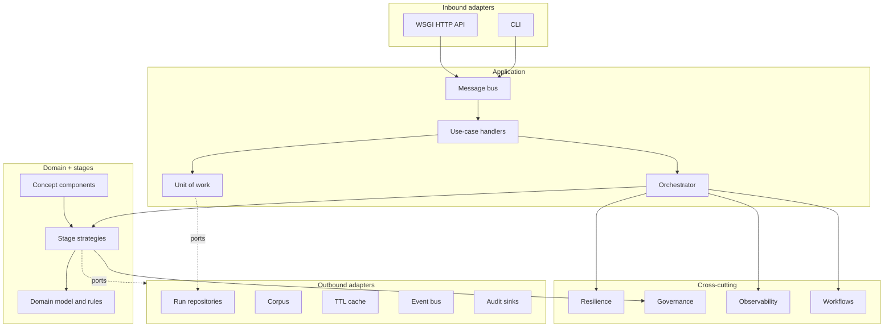
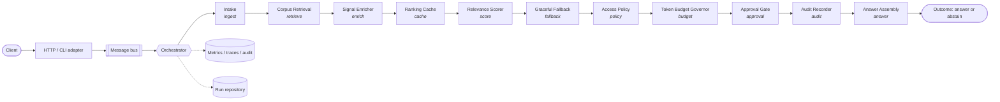
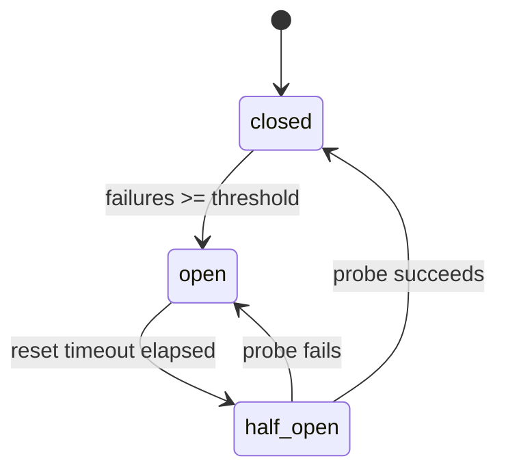
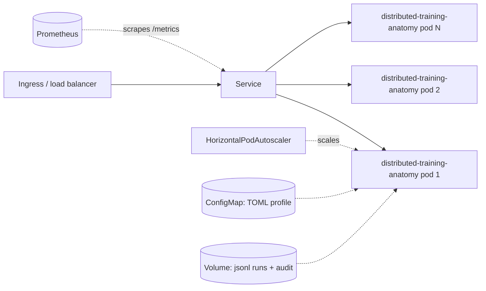

# Distributed Training Anatomy

Distributed Training Anatomy: Unraveling the Complexities of Large-Scale Model Training

[](.github/workflows/ci.yml)


This repository implements **Distributed Training Anatomy** as **Hexagonal pipeline with pluggable stages**. The concept path centres on **Signal Enricher**, **Ranking Cache**, **Token Budget Governor**, **Audit Recorder**, and **Approval Gate**. In this design, token and spend budgets are enforced before release, high-risk runs pause for human approval, and every decision is recorded for audit. The runtime uses only the Python standard library, so every behaviour in this README can be run and tested on a laptop in seconds.

## Contents

- [Why this exists](#why-this-exists)
- [Architecture at a glance](#architecture-at-a-glance)
- [Pipeline stages](#pipeline-stages)
- [Components](#components)
- [Quick start](#quick-start)
- [HTTP API](#http-api)
- [Configuration](#configuration)
- [Governance model](#governance-model)
- [Resilience model](#resilience-model)
- [Observability](#observability)
- [Design trade-offs](#design-trade-offs)
- [Failure modes](#failure-modes)
- [Project layout](#project-layout)
- [Testing strategy](#testing-strategy)
- [Extending the pipeline](#extending-the-pipeline)
- [Deployment](#deployment)
- [Design integrity](#design-integrity)
- [Limitations](#limitations)

## Why this exists

As AI models grow in size and complexity, training them efficiently requires distributing the workload across multiple computing resources. The challenge lies in managing data, tensor, and pipeline parallelism to optimize resource utilization, minimize communication overhead, and ensure scalability.

Pipeline parallelism offers a robust solution for distributed training of large-scale models by efficiently overlapping computation and communication. By carefully managing stage workloads and communication strategies, it is possible to achieve significant improvements in training throughput and scalability.

Most write-ups of Hexagonal pipeline with pluggable stages stop at a box diagram. This repository goes further: every box is a module, every arrow is a port, and every failure mode named in the design has a test that injects it.

## Architecture at a glance

**Distributed Training Anatomy** follows **Hexagonal pipeline with pluggable stages**.

Concept components and how they collaborate:

- **Signal Enricher** (`enrich`): Annotates candidates with token counts and query overlap, and collapses duplicate passages.

- **Ranking Cache** (`cache`): Short-circuits repeated identical requests with a TTL-bounded ranking cache keyed by principal.

- **Token Budget Governor** (`budget`): Enforces per-request and global token ceilings before evidence reaches the answer stage.

- **Audit Recorder** (`audit`): Writes a hash-chainable audit record for every run, including denials and degradations.

- **Approval Gate** (`approval`): Routes runs touching restricted material to a human approver before release.

- **Relevance Scorer** (`score`): Scores query-candidate relevance with a deterministic BM25-style reference model.

The service is hexagonal: inbound adapters (HTTP, CLI) drive an application bus; domain rules and stage strategies sit inside; outbound adapters implement ports for persistence, corpus access, caching, events, and audit. Only `container.py` wires concrete classes.



### Request flow



### Data flow

1. Signal Enricher (enrich): Annotates candidates with token counts and query overlap, and collapses duplicate passages.
2. Ranking Cache (cache): Short-circuits repeated identical requests with a TTL-bounded ranking cache keyed by principal.
3. Token Budget Governor (budget): Enforces per-request and global token ceilings before evidence reaches the answer stage.
4. Audit Recorder (audit): Writes a hash-chainable audit record for every run, including denials and degradations.
5. Approval Gate (approval): Routes runs touching restricted material to a human approver before release.
6. Relevance Scorer (score): Scores query-candidate relevance with a deterministic BM25-style reference model.

## Pipeline stages

For **Distributed Training Anatomy**, the default stage order is `intake`, `corpus_retrieval`, `signal_enricher`, `ranking_cache`, `relevance_scorer`, `graceful_fallback`, `access_policy`, `token_budget_governor`, `approval_gate`, `audit_recorder`, and `answer_assembly`. Stages are ordered by role so ingest comes first, policy and budget gates sit before release, and answer assembly is last. Override the topology with `pipeline.stages` in any profile or `DISTRIBUTED_TRAINING_ANATOMY_PIPELINE__STAGES`.

| # | Stage | Role | Critical | Source |
|---|---|---|---|---|
| 1 | `intake` (Intake) | `ingest` | yes | built-in |
| 2 | `corpus_retrieval` (Corpus Retrieval) | `retrieve` | no | built-in |
| 3 | `signal_enricher` (Signal Enricher) | `enrich` | no | [component](docs/components/signal_enricher.md) |
| 4 | `ranking_cache` (Ranking Cache) | `cache` | no | [component](docs/components/ranking_cache.md) |
| 5 | `relevance_scorer` (Relevance Scorer) | `score` | no | [component](docs/components/relevance_scorer.md) |
| 6 | `graceful_fallback` (Graceful Fallback) | `fallback` | no | built-in |
| 7 | `access_policy` (Access Policy) | `policy` | yes | built-in |
| 8 | `token_budget_governor` (Token Budget Governor) | `budget` | no | [component](docs/components/token_budget_governor.md) |
| 9 | `approval_gate` (Approval Gate) | `approval` | yes | [component](docs/components/approval_gate.md) |
| 10 | `audit_recorder` (Audit Recorder) | `audit` | no | [component](docs/components/audit_recorder.md) |
| 11 | `answer_assembly` (Answer Assembly) | `answer` | yes | built-in |

## Components

| Component | Role | Responsibility |
|---|---|---|
| [Signal Enricher](docs/components/signal_enricher.md) | `enrich` | Annotates candidates with token counts and query overlap, and collapses duplicate passages. |
| [Ranking Cache](docs/components/ranking_cache.md) | `cache` | Short-circuits repeated identical requests with a TTL-bounded ranking cache keyed by principal. |
| [Token Budget Governor](docs/components/token_budget_governor.md) | `budget` | Enforces per-request and global token ceilings before evidence reaches the answer stage. |
| [Audit Recorder](docs/components/audit_recorder.md) | `audit` | Writes a hash-chainable audit record for every run, including denials and degradations. |
| [Approval Gate](docs/components/approval_gate.md) | `approval` | Routes runs touching restricted material to a human approver before release. |
| [Relevance Scorer](docs/components/relevance_scorer.md) | `score` | Scores query-candidate relevance with a deterministic BM25-style reference model. |

Concept modules for **Distributed Training Anatomy** live under `src/distributed_training_anatomy/components/` (`signal_enricher/`, `ranking_cache/`, `token_budget_governor/`, `audit_recorder/`, `approval_gate/`, and `relevance_scorer/`). Each folder owns its config, port, service, validators, models, metrics, errors, and registry adapter.

## Quick start

```bash
python -m venv .venv && source .venv/bin/activate
pip install -e ".[dev]"
make test
python -m distributed_training_anatomy describe
python -m distributed_training_anatomy run examples/requests/governed_query.json
python -m distributed_training_anatomy serve --port 8080

# resume a paused high-risk run
# curl -X POST localhost:8080/v1/runs/$RUN_ID/approve -H 'content-type: application/json' \
#   -d '{"principal":{"subject":"admin","roles":["admin"]}}'
```

Library use for **Distributed Training Anatomy**:

```python
from distributed_training_anatomy import build_container
from distributed_training_anatomy.application.commands import RunPipeline

container = build_container()
outcome = container.bus.handle(RunPipeline(request={
    "query": 'How does Distributed Training Anatomy address: Explore data, tensor and pipeline parallelism?',
    "principal": {"subject": "alice", "roles": ["reader"], "groups": ["eng"]},
    "candidates": [{"doc_id": "a", "text": 'Explore data, tensor and pipeline parallelism.', "score": 0.8}],
}))
print(outcome["status"], outcome.get("answer"))
```

## HTTP API

| Method | Path | Purpose |
|---|---|---|
| GET | `/healthz` | Liveness for **Distributed Training Anatomy** |
| GET | `/readyz` | Readiness (stages loaded, breakers closed, hooks healthy) |
| GET | `/metrics` | Prometheus exposition for this service |
| GET | `/v1/pipeline` | Stage topology for `distributed_training_anatomy` |
| POST | `/v1/runs` | Execute a run of this pipeline |
| GET | `/v1/runs` | Recent run summaries |
| GET | `/v1/runs/{run_id}` | Full run record including checkpoints |
| POST | `/v1/runs/{run_id}/approve` | Approve a paused high-risk run for **Distributed Training Anatomy** |

A run returns HTTP `200` when completed or abstained, or `202` when it pauses in `awaiting_approval`. Errors share one envelope: `{"error": {"code", "message", "details"}, "request_id"}`. Full reference: [docs/api/http.md](docs/api/http.md) and [docs/api/openapi.yaml](docs/api/openapi.yaml).

## Configuration

Configuration for **Distributed Training Anatomy** follows precedence: code defaults < TOML profile (`--config` or `DISTRIBUTED_TRAINING_ANATOMY_CONFIG`) < environment (`DISTRIBUTED_TRAINING_ANATOMY_<SECTION>__<KEY>`). Unknown keys are rejected at startup.

Knobs that matter most for this design: `DISTRIBUTED_TRAINING_ANATOMY_PIPELINE__TOP_K`, `DISTRIBUTED_TRAINING_ANATOMY_CACHE__ENABLED`, `DISTRIBUTED_TRAINING_ANATOMY_BUDGET__DEFAULT_TOKENS`, `DISTRIBUTED_TRAINING_ANATOMY_GOVERNANCE__APPROVAL_RISK_THRESHOLD`, and `DISTRIBUTED_TRAINING_ANATOMY_GOVERNANCE__REDACT_PII`.

```bash
DISTRIBUTED_TRAINING_ANATOMY_PIPELINE__TOP_K=5 DISTRIBUTED_TRAINING_ANATOMY_CACHE__ENABLED=false python -m distributed_training_anatomy config
```

Profiles: [`config/default.toml`](config/default.toml), `development.toml`, `production.toml`, `test.toml`. Reference: [docs/api/configuration.md](docs/api/configuration.md).

## Governance model

Governance for **Distributed Training Anatomy** is centred on **Token Budget Governor**, **Audit Recorder**, and **Approval Gate**, with supporting pipeline controls around the run.

- **Operation authorization:** callers need `run:create` and `run:approve` before they can drive **Distributed Training Anatomy**.
- **Token Budget Governor** (`budget`): Enforces per-request and global token ceilings before evidence reaches the answer stage.
- **Audit Recorder** (`audit`): Writes a hash-chainable audit record for every run, including denials and degradations.
- **Approval Gate** (`approval`): Routes runs touching restricted material to a human approver before release.
- **Fail-closed access policy:** tenant, clearance, and ACL checks deny by default; if the policy stage fails, no candidate survives.
- **PII redaction:** e-mail, phone, SSN, and card numbers are redacted before text reaches answer assembly in **Distributed Training Anatomy**.
- **Evidence-backed release:** answer assembly abstains when surviving evidence is insufficient for **Distributed Training Anatomy**.

Details: [docs/architecture/governance.md](docs/architecture/governance.md), [docs/architecture/security.md](docs/architecture/security.md).

## Resilience model

**Distributed Training Anatomy** treats `intake`, `access_policy`, `approval_gate`, and `answer_assembly` as critical (failure stops or fails closed). Non-critical stages such as `corpus_retrieval`, `signal_enricher`, `ranking_cache`, `relevance_scorer`, and `graceful_fallback` degrade and continue when possible.

| Mechanism | Scope | Behaviour for this service |
|---|---|---|
| Circuit breaker | per stage | closed → open after N failures → half-open after reset |
| Retry | per stage call | exponential backoff, retryable errors only |
| Deadline | per stage | overruns are flagged in events and metrics |
| Bulkhead | per process | rejects work beyond the in-flight limit |
| Rate limiter | per tenant | token bucket on mutating HTTP calls |
| Fallback | pipeline | restores prior-score order when a non-critical stage degrades |



Details: [docs/architecture/resilience.md](docs/architecture/resilience.md).

## Observability

Observability is first-class for **Distributed Training Anatomy**:

- Structured JSON logs with run and request ids.
- In-process tracing with nested spans (`run` → `stage:<name>`).
- Prometheus metrics: `pipeline_runs_total`, `stage_executions_total`, `stage_duration_ms`, plus `component_signal_enricher_runs_total`, `component_ranking_cache_runs_total`, `component_token_budget_governor_runs_total`, and `component_audit_recorder_runs_total`.
- Per-stage checkpoints stored with every run record.
- Domain events on an internal bus (`run.started`, `run.completed`, `run.abstained`, `run.failed`, `stage.degraded`, `candidate.denied`, and `approval.requested`).

## Design trade-offs

See [docs/trade-offs.md](docs/trade-offs.md).

The structural decisions are recorded as ADRs in [docs/adr/](docs/adr/).

## Failure modes


Per-stage behaviour in this repository:
| Stage | Role | On failure |
|---|---|---|
| `intake` (Intake) | `ingest` | Run fails; the request never reaches retrieval. |
| `corpus_retrieval` (Corpus Retrieval) | `retrieve` | Run degrades; supplied candidates (if any) continue. |
| `signal_enricher` (Signal Enricher) | `enrich` | Run degrades; candidates continue without annotations. |
| `ranking_cache` (Ranking Cache) | `cache` | Run degrades; the request is treated as a cache miss. |
| `relevance_scorer` (Relevance Scorer) | `score` | Run degrades; fallback restores upstream prior order. |
| `graceful_fallback` (Graceful Fallback) | `fallback` | Run degrades; ordering from the last healthy stage is kept. |
| `access_policy` (Access Policy) | `policy` | Run fails closed: no candidates survive, the run abstains with `policy_unavailable`. |
| `token_budget_governor` (Token Budget Governor) | `budget` | Run degrades; the answer stage still applies `top_k`. |
| `approval_gate` (Approval Gate) | `approval` | Run fails; nothing is released without an approval decision. |
| `audit_recorder` (Audit Recorder) | `audit` | Run degrades; the answer is still returned and the gap is visible in metrics. |
| `answer_assembly` (Answer Assembly) | `answer` | Run fails with `stage_failure:<name>`. |

These behaviours are listed in [docs/failure-modes.md](docs/failure-modes.md) and exercised in `tests/integration/test_degradation.py`.

## Project layout

```text
src/distributed_training_anatomy/
├── kernel/          # Result, errors, ids, clock, specification helpers
├── config/          # typed settings, TOML + env loader
├── domain/          # entities, policies, and invariants for Distributed Training Anatomy
├── ports/           # protocols the core needs
├── stages/          # role strategies used by this pipeline
├── components/      # concept components for Distributed Training Anatomy
│   ├── signal_enricher/     # Signal Enricher (enrich)
│   ├── ranking_cache/     # Ranking Cache (cache)
│   ├── token_budget_governor/     # Token Budget Governor (budget)
│   ├── audit_recorder/     # Audit Recorder (audit)
│   ├── approval_gate/     # Approval Gate (approval)
│   ├── relevance_scorer/     # Relevance Scorer (score)
├── application/     # orchestrator, handlers, bus, unit of work
├── resilience/      # breaker, retry, deadline, bulkhead, rate limiter
├── governance/      # policy engine, approvals, budgets, RBAC, redaction
├── observability/   # logging, tracing, metrics, audit, health
├── workflows/       # run state machine and checkpoints
├── plugins/         # stage registry and lifecycle hooks
├── adapters/        # HTTP, CLI, and outbound adapters
├── container.py     # composition root
└── stage_catalog.py # default topology for distributed-training-anatomy
tests/               # unit, integration, contract, property, e2e
docs/                # architecture, ADRs, components, runbooks, API
deploy/              # Kubernetes manifests and Helm chart
examples/            # sample requests and corpus for Distributed Training Anatomy
benchmarks/          # throughput and latency harness
```

## Testing strategy

| Layer | Location | What it proves for **Distributed Training Anatomy** |
|---|---|---|
| Unit | `tests/unit/` | each module in isolation with fake clocks and in-memory adapters |
| Component | `tests/unit/components/` | `test_component_signal_enricher.py`, `test_component_ranking_cache.py`, `test_component_token_budget_governor.py`, and `test_component_audit_recorder.py` honour their contracts |
| Contract | `tests/contract/` | adapters satisfy ports; every registered stage honours the stage contract |
| Integration | `tests/integration/` | orchestrator, HTTP, CLI, budget exhaustion, approval flow, degradation, and breaker behaviour |
| Property | `tests/property/` | seeded randomized requests never violate ordering or access invariants |
| Scenario | `tests/e2e/` | data-driven scenarios in `tests/fixtures/scenarios.json` |

```bash
make test
make test-fast
make bench
```

## Extending the pipeline

Register a new stage for **Distributed Training Anatomy** without touching the orchestrator:

```python
from distributed_training_anatomy.plugins.registry import StageRegistry
from distributed_training_anatomy.stage_catalog import register_all
from distributed_training_anatomy.stages.base import Stage

class DistributedSignal(Stage):
    role = 'score'
    def process(self, ctx):
        # project-specific enrichment for Distributed Training Anatomy
        for c in ctx.candidates:
            c.score += 0.01
        ctx.candidates.sort(key=lambda c: -c.score)

registry = StageRegistry()
register_all(registry)
registry.register('distributed_signal', 'score', lambda s: DistributedSignal('distributed_signal', s), source="plugin")
```

Then add `'distributed_signal'` to `pipeline.stages`. See
[docs/guides/extending-stages.md](docs/guides/extending-stages.md) and
[examples/custom_stage_plugin.py](examples/custom_stage_plugin.py).

## Deployment

- Container image: [`Dockerfile`](Dockerfile) (non-root, health-checked) for `distributed_training_anatomy`.
- Local stack: [`docker-compose.yml`](docker-compose.yml).
- Kubernetes: [`deploy/k8s/`](deploy/k8s/) (Deployment, Service, HPA, PDB, NetworkPolicy, ConfigMap).
- Helm: [`deploy/helm/distributed-training-anatomy/`](deploy/helm/distributed-training-anatomy/).



## Design integrity

Design decisions for **Distributed Training Anatomy** are recorded as ADRs under [docs/adr/](docs/adr/). The executable test suite in this repository is the authoritative check of runtime behaviour.

## Limitations

- The reference scorer is lexical (BM25-style). Production deployments should register a learned relevance model behind the same `RelevanceScorer` port.
- Persistence is in-memory or JSON Lines. Use a transactional store behind `RunRepository` for multi-replica deployments of **Distributed Training Anatomy**.
- The event bus and tracer are in-process. Bridge them to your platform's messaging and tracing systems via the provided ports.
- Approval tokens use a static development secret by default. Inject a managed secret in production.
- Budget accounting in the reference build is token-oriented; map monetary or tool-call ceilings onto the same budget port for production limits.

## License

MIT. See [LICENSE](LICENSE).
